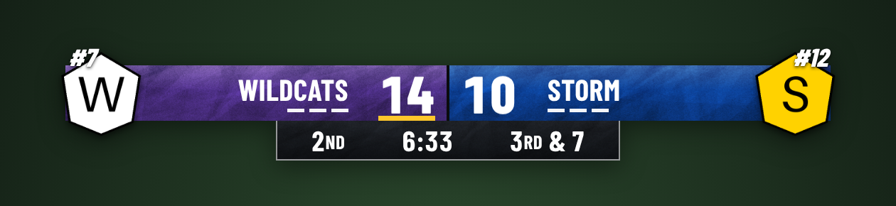
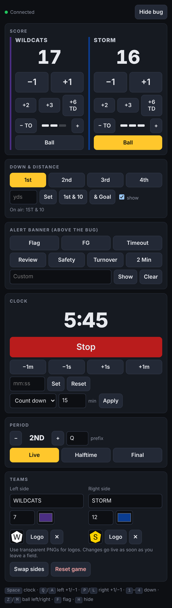

<div align="center">



# Scorebug

**A broadcast-style football score bug for OBS. Free, offline, and zero dependencies.**

[](https://nodejs.org)
[](#-quick-start)
[](https://obsproject.com)
[](#)
[](LICENSE)

[Quick start](#-quick-start) · [OBS setup](#-obs-setup) · [Controls](#-controls) · [Hotkeys](#%EF%B8%8F-hotkeys) · [Troubleshooting](#-troubleshooting)

</div>

---

## 🎬 Demo

<div align="center">

<br>
<sub>Field goal roll → touchdown flood → timeout flash → flag fill → under review</sub>
</div>

---

## ✨ Features

| | |
|---|---|
| 🏈 **Broadcast layout** | Team-color panels, logos, rankings, timeout pips, possession marker, quarter / clock / down & distance |
| 🔢 **Rolling scores** | Points scroll up odometer-style. Corrections scroll down. |
| 💥 **Touchdown flood** | `+6 TD` wipes the whole bug in the scoring team's color, then rolls the new score in as it clears |
| ⏸️ **Timeout flash** | `− TO` flashes that team's half white three times |
| 🚩 **Flag & review fills** | Yellow (flag) or red (review) rises from the bottom, then drains, leaving a tab up until cleared |
| 📄 **Paper texture** | Crumpled-paper finish over every surface, blended with any team color |
| ⏱️ **Drift-free clock** | Timestamp-based. Counts down or up, auto-stops at 0:00, shows `:18` under a minute. |
| 💾 **Crash-safe** | Game state saves to disk. Restart mid-game and nothing's lost. |
| 📱 **Phone control** | Optional. Run the board from your phone over wifi. |
| 🔌 **Fully offline** | Fonts and textures are bundled. No internet needed at the field. |

---

## 🚀 Quick start

**1. Install [Node.js](https://nodejs.org)** (the LTS version). One time only.

**2. Download this repo:** green **Code** button → **Download ZIP** → unzip it somewhere permanent.

**3. Start it:**

<table>
<tr><th>macOS</th><th>Windows</th></tr>
<tr valign="top"><td>

Double-click **`start.command`**

First run, macOS blocks it. Go to **System Settings → Privacy & Security** → scroll down → **Open Anyway**.

If you see *permission denied*, run once in Terminal:
```bash
chmod +x start.command
```

</td><td>

Double-click **`start.bat`**

If Windows SmartScreen pops up: **More info → Run anyway**.

</td></tr>
</table>

A window opens saying **Score bug running**. Leave it open while you stream.

---

## 📺 OBS setup

**The overlay:** Sources → **+** → **Browser**

| Setting | Value |
|---|---|
| URL | `http://localhost:8787/overlay` |
| Width | `1920` |
| Height | `1080` |

**The control panel:** **Docks → Custom Browser Docks**

| Dock Name | URL |
|---|---|
| `Scoreboard` | `http://localhost:8787/` |

Drag the dock wherever you want. Done.

---

## 🎛️ Controls



**Score:** `+1` `+2` `+3` `+6 TD` `−1` per team. `+6 TD` triggers the touchdown flood.

**Timeouts:** `− TO` uses one (with flash). `+` gives one back.

**Ball:** marks possession with the yellow bar.

**Down & distance:** one tap for 1st through 4th, type the yards, or `& Goal`.

**Alert banner:** Flag, FG, Timeout, Review, Safety, Turnover, 2 Min, or custom text. Flag and Review also trigger the fill.

**Clock:** start/stop, nudge ±1s or ±1m, set exact time, count up or down, set period length.

**Period:** 1ST to 4TH, then OT, 2OT... Halftime and Final replace the clock.

**Teams:** name, rank, color, and logo upload. Changes go live instantly. Swap sides, reset game.

<br clear="right">

---

## ⌨️ Hotkeys

Click into the control panel first.

| Key | Action |
|:---:|---|
| `Space` | Start / stop clock |
| `Q` / `A` | Left team +1 / −1 |
| `P` / `L` | Right team +1 / −1 |
| `1`–`4` | Set down |
| `Z` / `M` | Ball to left / right |
| `F` | Toggle flag |
| `H` | Hide / show bug |

---

## 📱 Phone control

Run **`start-phone.command`** (Mac) or **`start-phone.bat`** (Windows) instead. The window prints a URL; open it on your phone (same wifi).

> [!WARNING]
> Anyone on the same network can open that URL and change the score. Don't use phone mode on public or school wifi.

---

## 🎨 Customizing

| What | Where |
|---|---|
| Paper texture strength | `overlay.html` → `--paper, .9` (`0` off, `1` max) |
| Flag / review colors and text | `overlay.html` → `FILLS` |
| Alert tab colors | `overlay.html` → `BANNER` |
| Bug position | `overlay.html` → `.wrap { bottom: 64px }` |
| Port | `PORT=9000 node server.js` |

**Logos:** use transparent PNGs, roughly square, 300px+. JPGs get a box around them.

---

## 🧯 Troubleshooting

<details>
<summary><b>Overlay is blank in OBS</b></summary>

- Is the Terminal / command window still open and saying *Score bug running*? If not, start it again.
- Right-click the browser source → **Refresh**.
- Check the URL is exactly `http://localhost:8787/overlay`.
</details>

<details>
<summary><b>"Node.js isn't installed" but I installed it</b></summary>

Fully quit Terminal (Cmd+Q) or the command window and start again. A restart of the computer fixes it if not.
</details>

<details>
<summary><b>"Port already in use"</b></summary>

It's already running in another window. Close the extra window and use the one that's open.
</details>

<details>
<summary><b>Wrong score after a mistake</b></summary>

Use `−1` until it's right. It rolls down instead of up. Touchdown animations only fire on `+6 TD`.
</details>

<details>
<summary><b>Start over for a new game</b></summary>

**Reset game** in the Teams section. Clears scores, timeouts, period, downs, and clock, but keeps teams and logos.
</details>

---

## 📁 Project layout

```
scorebug/
├── server.js            # tiny Node server: state, events, logo uploads
├── overlay.html         # the bug (OBS browser source)
├── control.html         # the control panel (OBS dock)
├── start.command        # macOS launcher
├── start.bat            # Windows launcher
├── start-phone.*        # launchers with phone control on
├── fonts/               # Barlow Condensed (bundled for offline use)
├── textures/paper.png   # generated paper texture
└── logos/               # your uploaded logos (created automatically)
```

---

## 🙏 Credits

- [Barlow Condensed](https://github.com/jpt/barlow) by Jeremy Tribby, licensed under the SIL Open Font License 1.1
- Built by Nathan Ramzy

## 📄 License

[MIT](LICENSE). Use it, fork it, put it on your stream.
